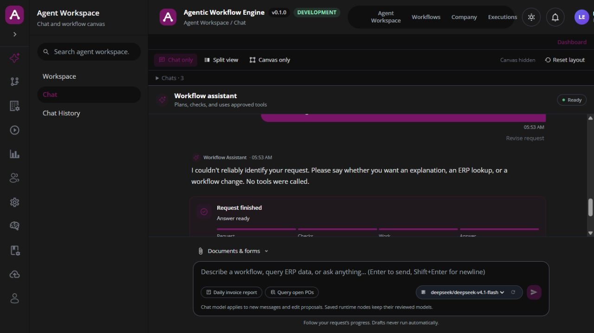

# Inventory, record creation and editing QA

Date: 17 October 2026, Asia/Colombo.

## Result

**Not a complete CRUD pass.** Direct reads from the hosted ERPBridge work. The current low-code app cannot yet be qualified for creating/editing inventory records or adding stock quantity.

Three separate conditions were observed:

1. The local backend had lost its database writer authority after the long idle interval. Login returned HTTP 500 and `/healthz` returned HTTP 503. The saved exception was `Authoritative storage ownership is unavailable; dispatch is fenced`. No active chat operations were present. Only the verified local backend process was restarted; the same emulator data was retained, health became healthy, and login worked. The lease was not deleted or bypassed. The exact original lease-loss trigger was not independently established; this is not evidence of an ERPBridge or model failure, and a restart is operational recovery rather than a source-level resilience repair.
2. The current OpenRouter provider test returned `ok: false` and `OpenAI-compatible provider returned HTTP 401`. All five new chat requests recorded `PROVIDER_FAILED`; none performed ERP tool calls. The same configured model worked in the previous day's test, but that does not prove the key is valid now. The reason for the provider's rejection was not established beyond HTTP 401.
3. Fresh hosted discovery still advertises create/update tools as serving aliases. The current low-code importer permits only reviewed, digest-pinned read aliases and rejects these write aliases. Their output contracts are generic objects, not reviewed success/readback contracts. Only Company/Department reads are currently approved in this isolated app workspace; inventory read tools have not been silently granted to it.

The model-key failure happens before meaningful chat intent classification. Therefore the failed chat attempts do **not** demonstrate successful create/edit dispatch, successful approval handling, or the inventory-permission refusal path. Source/contract inspection and separate governance tests establish those boundaries independently.

## Environment and scope

- Local frontend: http://127.0.0.1:5196/
- Local backend: http://127.0.0.1:8081/
- Isolated loopback Firestore emulator: `127.0.0.1:23671`, workspace `hosted-bridge-local-native`.
- Real hosted ERPBridge: https://erpbridge.nimendra.online/mcp/
- Configured model: `deepseek/deepseek-v4.1-flash`, via OpenRouter.
- Retained test chat: http://127.0.0.1:5196/chat/chat_65_2c15df7a

No ERP create/update/delete/submit/cancel operation, warehouse balance adjustment, email, business schedule, role grant, capability import or hosted deployment was performed. No ERPBridge/RAG/pipeline source was changed. Application logic was not changed in this pass; only local QA probes and this report were added. The frontend and emulator were not restarted.

## Direct hosted ERP read checks

These used the real low-code MCP transport adapter in a read-only diagnostic session, without the model and without claiming that its permissions equal the app's reviewed registry. Every direct dispatch was guarded to select an advertised read-only tool.

| # | Scenario | Result |
| --- | --- | --- |
| 1 | First item page, size 3, stable `name asc` order | Passed; 3 records |
| 2 | Next item page, offset 3 | Passed; 3 different records, no page overlap |
| 3 | Fetch one exact item by its returned record name | Passed; item code matched the list response |
| 4 | Fetch 5 item/warehouse balance rows | Passed; numeric actual quantities and exact warehouse identities returned |
| 5 | Filter stock balances by one exact returned item code | Passed; 2 matching warehouse rows, no unrelated item |
| 6 | Search for a uniquely named nonexistent QA item | Passed; empty array, not fabricated data or an exception |
| 7 | Fetch a bounded warehouse page | Passed; 5 records |
| 8 | Fetch a bounded stock-entry page | Passed; 3 submitted documents (`docstatus: 1`) |
| 9 | Fetch one exact existing stock entry | Passed; exact identity/status matched and 4 item rows returned |

In the repeat diagnostic, these individual ERP reads took approximately 135–161 ms. This excludes model routing, governance, persistence, browser rendering and full totals; it is not end-to-end chat latency. Stock quantities were read, never adjusted.

## Live chat/API and UI checks

Four new asynchronous requests were submitted once through the local API with distinct idempotency keys; a fifth was submitted through the actual browser UI:

| Scenario | Observed outcome | Business status |
| --- | --- | --- |
| List the first five inventory items | Provider failed before tool selection | Retrieval through chat blocked |
| Create synthetic item `LCWE-QA-20261017-ITEM` | Provider failed; zero tool steps | Item not created |
| Rename only that synthetic item | Provider failed; zero tool steps | No record edited |
| Prepare a draft Material Receipt without posting | Provider failed; zero tool steps | No stock receipt created |
| UI request for warehouse stock of `FG-SOAP-100` | Provider failed; zero tool steps | No stock result returned by chat |

The API acknowledged the four requests in 142–157 ms and retained their completed fallback responses. Fast failure is **not** fast successful ERP execution. The coherent emulator snapshot showed five failed model invocations, five terminal chat operations, zero active operations and zero saved workflows.

Actual browser observations:

- Expired sign-in redirected to the login page; existing local QA credentials worked after backend recovery.
- Sign-in inputs and duplicate sign-in controls disabled while signing in.
- A stock request changed the assistant to `Working`; send/revise controls, attachment controls, model selection and prompt shortcuts disabled; Cancel appeared.
- Controls recovered after the fallback reply, and the same saved chat showed all requests/replies.
- **Confirmed usability defect:** provider rejection is displayed as `I couldn't reliably identify your request...` with `Answer ready`. The actual reason is `PROVIDER_FAILED`/HTTP 401, not unclear user wording. The UI/backend should distinguish unavailable provider credentials, transient service failure, and genuine clarification; an operation being terminal must not imply business success.

## Fresh inventory contract check

Hosted discovery returned 152 tools.

| Tools | Advertised | Current importer | Current local app |
| --- | --- | --- | --- |
| `list_items`, `get_item`, `list_bins`, `list_warehouses`, `list_stock_entries`, `get_stock_entry` | Read-only aliases with version/digest metadata | Importable for explicit review | Not yet approved for the local role |
| `create_item`, `update_item`, `insert_document`, `update_document`, `submit_document` | Effectful serving aliases with generic object outputs | Not importable under the existing read-alias compatibility path | Not executable |

Tool discovery, an administrator token, and a generated workflow do not establish write permission or transaction success. Simply changing an effect tool's `is_read_only` flag or skipping contract matching would invalidate the test and weaken the system.

Relevant implementation locations:

- `backend-ts/src/registry/discovered-contract.ts`: exact-version or explicitly reviewed read-alias admission.
- `backend-ts/src/tools/erpbridge-contract.ts`: exact name/version/digest/schema matching.
- `backend-ts/src/registry/capability-import.ts`: explicit role/effect/result review and independent approval requirements.
- `backend-ts/src/registry/schemas.ts`: reviewed `operation_contract` confirmation and optional readback contracts.
- `backend-ts/src/agent/intent-router.ts`: current generic fallback after provider failure.
- `backend-ts/src/storage/firestore-records.ts` and `firestore-writer-ownership.ts`: writer renewal/fencing behavior.

## Automated regression checks run today

| Check | Result |
| --- | --- |
| Backend: capability import/admission, runtime approvals, approval containment, protected effects | **180 passed, 0 failed** |
| Frontend: capability review/import UI, runtime review, operation recovery, chat messages/progress | **111 passed, 0 failed**, 6 suites |
| `git diff --check` | Passed; existing LF/CRLF notices only |

The initial direct Jest invocation omitted the repository's ESM runner flag and failed before executing tests. It was rerun using the package's actual `npm test` command and all 111 selected tests passed. That harness failure was not treated as an application bug. The complete frontend/backend suites were not rerun today. Automated approval tests are not a replacement for live ERP create/edit/readback evidence.

## Required next acceptance sequence

1. Replace the rejected key through the local Models/Providers UI, without sharing the key in chat; require the provider test to pass.
2. Explicitly review a small local inventory read pack for Platform Admin. Re-run item listing, exact fetch, warehouse stock, empty results and bounded paging through the **chat UI**.
3. Qualify low-code support for the hosted effect contracts. Preserve the exact digest/version/schema, explicit local effect classification, independent approval, one-time dispatch, cancellation fencing and no blind retry. A generic result object is not sufficient proof of success. If the hosted service cannot supply the necessary contract/receipt semantics, coordinate with its owner rather than claiming a backend-only patch solves it.
4. Create one uniquely named synthetic item master, resolve exact Item Group/UOM, verify its identity with ERP readback, then edit a non-sensitive field on **only that test record** and read it back again.
5. Try duplicate item code, missing UOM/group, nonexistent record, rejected/cancelled approval, revoked access and malformed input. Assert zero unintended side effects and no fabricated success.
6. Create a draft stock receipt with exact company/warehouse/item/quantity/UOM and inspect its persisted child rows. **Draft creation is not stock addition.**
7. Only after a separate explicit posting approval in the isolated demo ERP, submit the receipt once and compare the same item+warehouse quantity before/after and the posted stock ledger. A timeout after dispatch requires reconciliation of the original operation, never an automatic second receipt.
8. Test a draft edit, a submitted-document edit refusal, multi-warehouse balances, and permission differences between builder/operator/reviewer roles using their own tokens.
9. Preserve receipts, role decisions, before/after reads, screenshots and saved workflow versions before any deployment claim.

Permission for the source/role changes and a valid provider remain pending. No complete create/edit/add-stock success is claimed by this report.

## Reproducible evidence

Private local artifacts (contain local configuration/business details; do not publish emulator exports):

- `ops/deployment/local/inventory-current-20261017.local.json` — initial storage-fenced login failure plus 9 direct read checks.
- `ops/deployment/local/inventory-after-restart-20261017.local.json` — repeat direct checks and four API chat cases.
- `ops/deployment/local/inventory-outcome-20261017.local.json` — coherent metadata-only snapshot including the fifth browser-submitted request.
- `tmp/local-performance-20261016/inventory-authority-20261017.json` — backend regression results.
- `tmp/local-performance-20261016/inventory-ui-components-qualified-20261017.json` — qualified frontend regression results.
- `tmp/local-performance-20261016/backend-fast.stdout.local.log` — earlier backend's fenced error.
- `tmp/local-performance-20261016/backend-20261017.stdout.local.log` — recovered local backend.
- `tmp/local-performance-20261016/emulator-inventory-20261017` — fresh retained emulator export after all five chat requests became terminal. The local startup helper now prefers it; prior exports remain available. This export has not been restore-rehearsed.

The QA probe refuses ERP effect dispatch. Do not use it as a mutation shortcut or as proof that create/edit is enabled.
